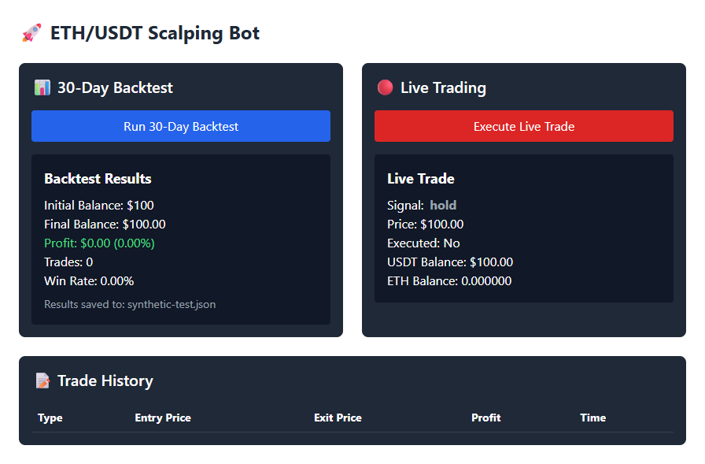

# quantumSector

A personal Next.js/React experiments repository by Ramtin. The current home page mounts a trading test interface with a TradingView chart and buttons for a separate localhost API. Reminder, countdown and voice-recorder experiments remain in the source but are commented out of the home page. This is an unfinished prototype, not the [Quantum](https://github.com/boyInShadows/Quantum) animated agency page or a published portfolio.



The capture shows the running development page's result component. Responses are synthetic, with zero profit and no executed trade. The external chart constructor was stubbed during verification; the chart is outside this crop. No trading backend or exchange was contacted.

## Local development

Verification used Node 24.11.1 on Windows; no Node engine is declared.

```bash
git clone https://github.com/boyInShadows/quantumSector.git
cd quantumSector
npm ci
npm run dev
```

Open http://localhost:3000. The page loads TradingView's third-party script. Buttons POST JSON to `http://localhost:5000/backtest` (`initial_balance:100, days:30`) and `/live` (`initial_balance:100`). This repository supplies no backend, credentials or environment-based API configuration. Those endpoint names match the separate [PyCode experiment](https://github.com/boyInShadows/PyCode/tree/master/TradingBot), but integrated operation was not verified. Inspect that service independently before running it.

## Checks and current limits

- `npm ci` passed. `npm run lint` fails on five unused-variable/import errors and reports one reminder cleanup warning. `npx tsc --noEmit` fails on reminder DatePicker nullability, voice-recorder types and timer state. `npm run build` compiles the bundle but exits 1 at type validation. These gates remain enabled; production `npm start` requires a successful build first.
- Edge verified both buttons' POST contracts and synthetic result rendering at desktop/mobile sizes. A small contrast fix gives the dark result cards an explicit white foreground; a computed-color regression failed before and passed afterward.
- There is no automated test suite or quality CI. Real APIs, network-failure recovery, TradingView rendering, microphone/speech support, timer persistence, full accessibility and device behavior remain unverified.

[Home](app/page.tsx) selects the experiment; [BotTestPage](app/components/tradingTest/botTestPage.jsx) owns request/loading/result state. It assumes successful JSON with specific numeric fields, does not check HTTP status and only logs failures. Malformed responses can fail rendering. The chart loader lacks cleanup and a failure fallback. Dormant voice code does not fully manage recording/resource cleanup. These are explicit follow-up issues, not production-ready integrations.

The labels mention both BTC and ETH; chart configuration uses ETHUSDT. No strategy quality, financial returns or live execution capability is asserted by this README.
